# AI & Generative AI Fundamentals

[x] Introduction to Artificial Intelligence  
[x] Machine Learning Basics  
[x] NLP Fundamentals  
[x] Introduction to Generative AI  
[x] Real-world AI applications  
[x] AI tools ecosystem overview  

## Introduction to Artifical Intelligence

What is Artificial Intelligence?  
Artificial Intelligence (AI) refers to the simulation of human intelligence in machines that are programmed to think and learn like humans. These systems can perform tasks such as problem-solving, decision-making, language understanding, and perception.

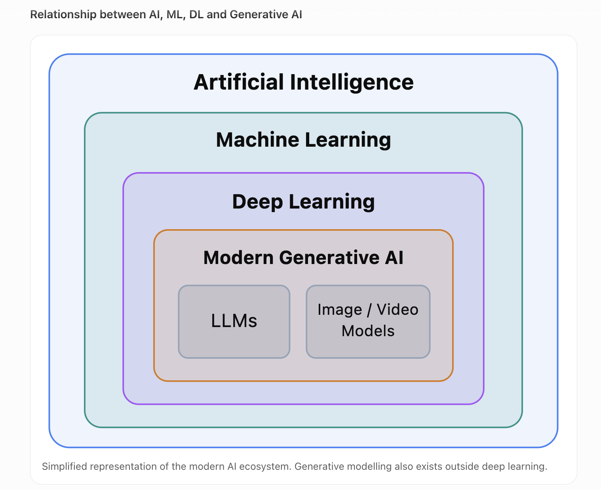

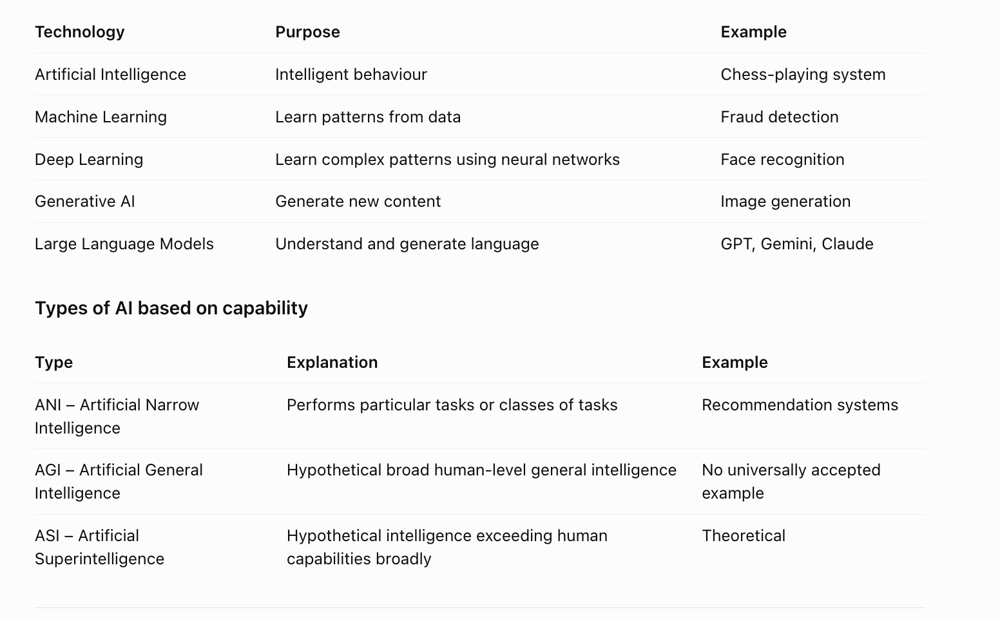

## Machine Learning Fundamentals

What is Machine Learning?

Machine Learning (ML) is a subset of AI that enables systems to learn from data and improve their performance over time without being explicitly programmed. ML algorithms identify patterns in data and make predictions or decisions based on those patterns.

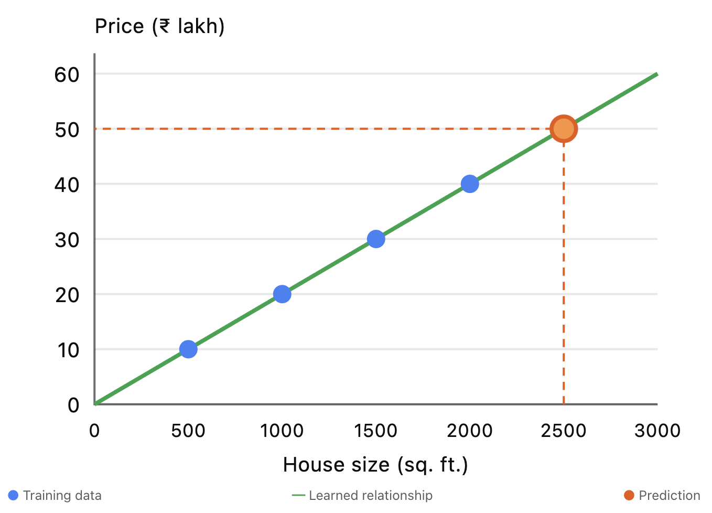

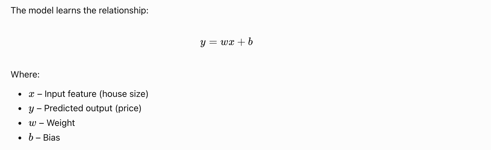

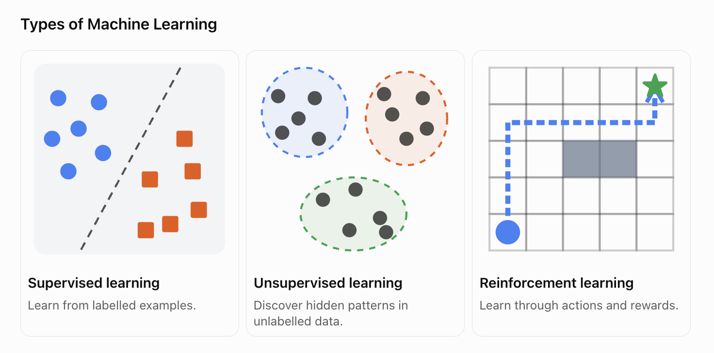

Supervised Learning:

Supervised Learning is a type of machine learning where the model is trained on labeled data. The algorithm learns the mapping between input features and the corresponding output labels, allowing it to make predictions on new, unseen data.

Types of Supervised Learning:

1. **Regression:** Predicting a continuous value based on input features.
2. **Classification:** Predicting a discrete label or category based on input features.

Unsupervised Learning:

Unsupervised Learning is a type of machine learning where the model is trained on unlabeled data. The algorithm tries to find hidden patterns or intrinsic structures in the input data without any explicit output labels. Common techniques include clustering.

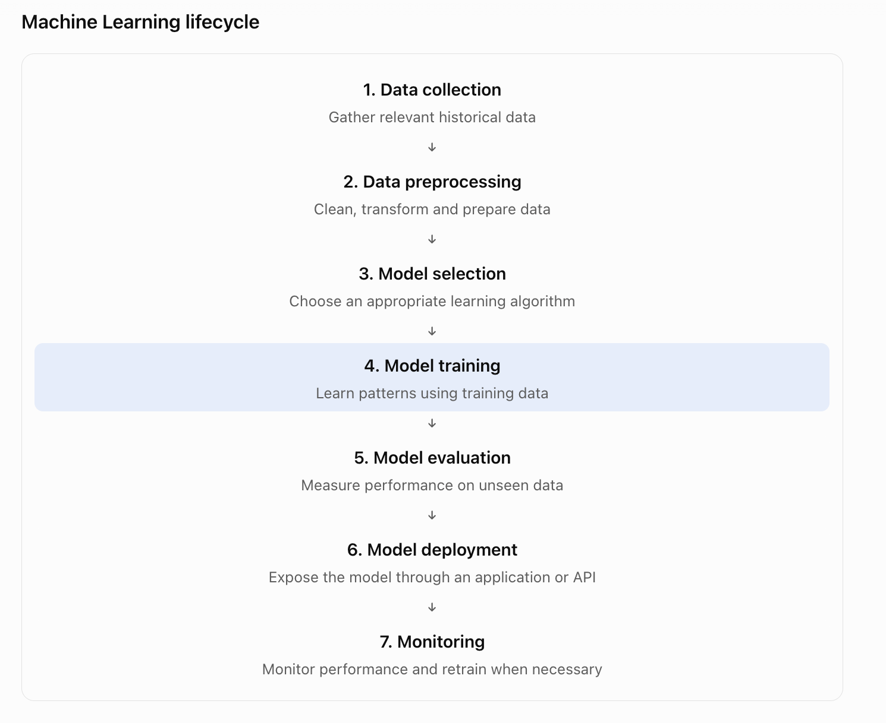

## Introduction to Deep Learning

Deep Learning is a subset of machine learning that focuses on neural networks with many layers (deep neural networks). These networks are capable of automatically learning hierarchical representations of data, making them particularly effective for tasks such as image recognition, natural language processing, and speech recognition.

What is Neural Network?

A Neural Network is a computational model inspired by the structure and function of the human brain. It consists of layers of interconnected nodes (neurons) that process and transmit information. Each connection has an associated weight that is adjusted during training to minimize the error in predictions. Neural networks are the foundation of deep learning and are particularly effective for tasks involving complex patterns and high-dimensional data.

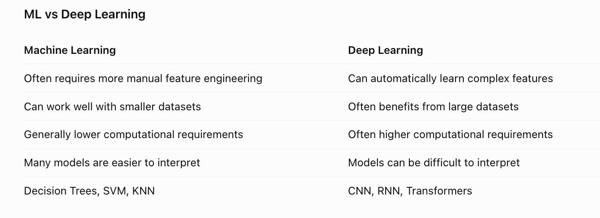

## Natural Language Processing

Natural Language Processing is a field of AI concerned with enabling computers to process, understand and generate human language.

Examples:
- Email spam detection
- Sentiment analysis
- Machine translation
- Chatbots and virtual assistants
- Voice assistants
- Search Engines
- Resume Screening

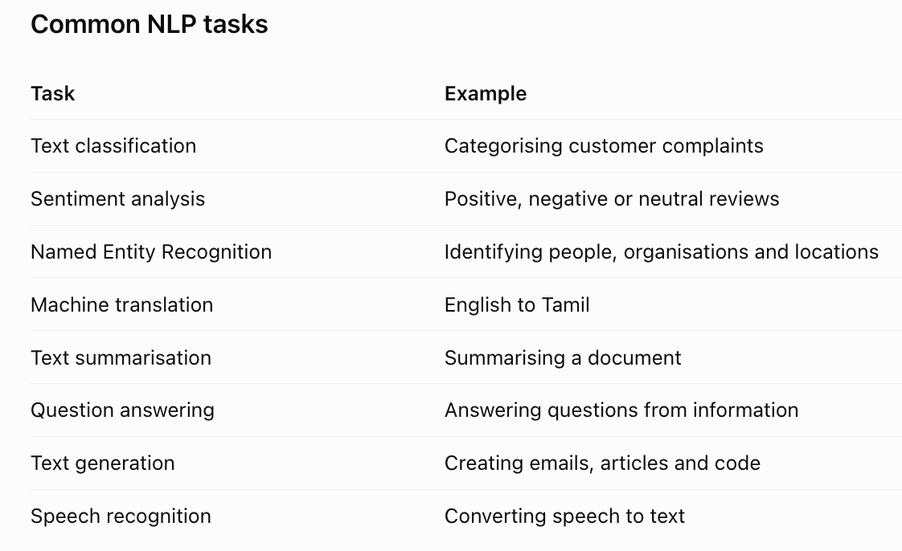

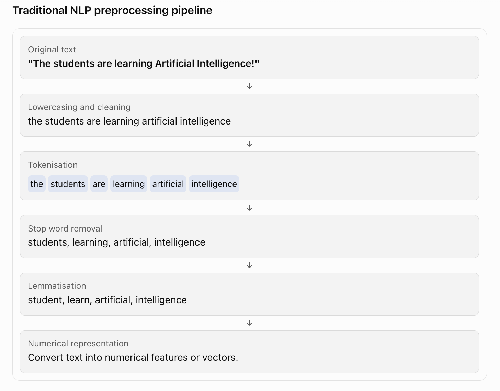

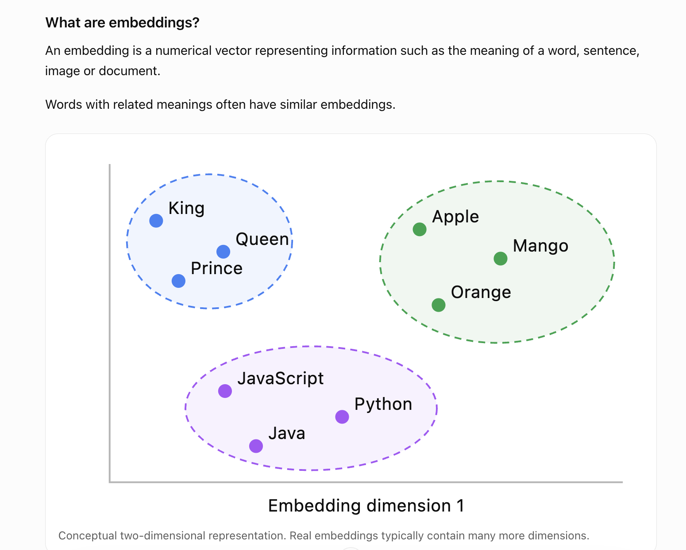

## Introduction to Generative AI

What is Generative AI?

Generative Artificial Intelligence is a category of AI capable of creating new content based on patterns learned from existing data.

It can generate text, programming code, images, audio, music, videos, presentations and synthetic data.

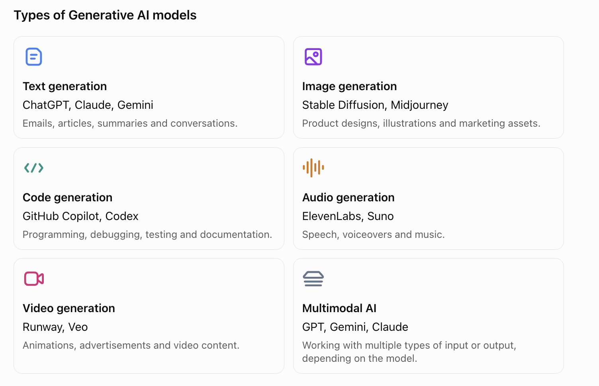

How does Generative AI work?

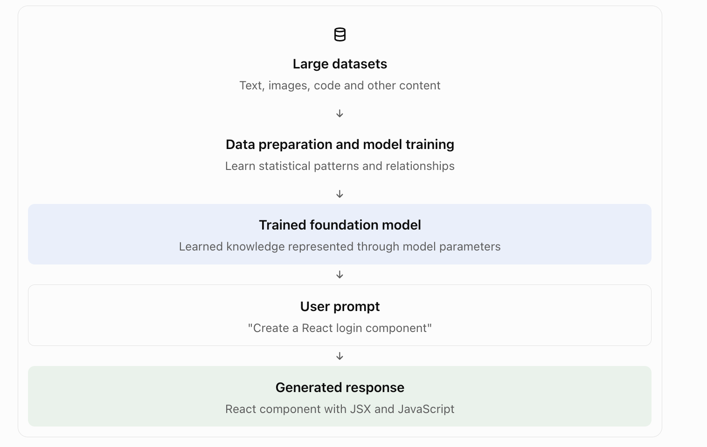

## AI Tools Ecosystem Overview

