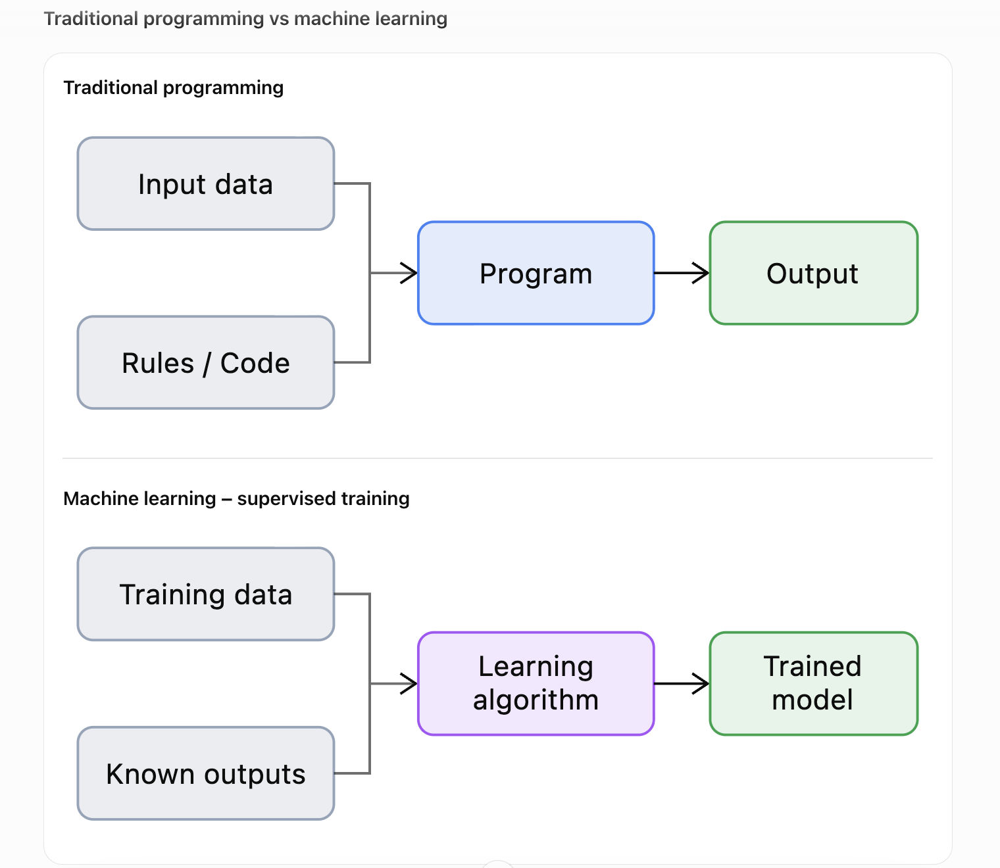

# System Design

## System Design Foundations

### What is System Design?

System design is the process of defining the architecture, components, modules, interfaces, and data for a system to satisfy specified requirements. It involves making high-level decisions about the structure and behavior of a system to ensure it meets both functional and non-functional requirements.

### Key Concepts in System Design

1. **Scalability**: The ability of a system to handle increased load without compromising performance.
2. **Reliability**: The ability of a system to function correctly and consistently over time.
3. **Availability**: The proportion of time a system is operational and accessible when needed.
4. **Maintainability**: The ease with which a system can be modified to fix issues, improve performance, or adapt to changing requirements.
5. **Performance**: The responsiveness and efficiency of a system under specific conditions.
6. **Security**: The protection of a system against unauthorized access and threats.

### Understanding the basic application architecture:

When a customer sends a request:

1. React sends an HTTP request to the Express server.
2. Express checks Redis for previously cached responses.
3. If a cached response is found, it is returned to React.
4. If no cached response is found, Express queries the database.
5. The database response is cached in Redis for future requests.
6. Express sends the response back to React.

### High level Design HLD vs Low level Design LLD

- **High Level Design (HLD)**: Focuses on the overall system architecture, components, and their interactions. It provides a bird's-eye view of the system and is used for understanding the system's structure and design decisions.
Example:

React -> Express API -> Redis / Database

- **Low Level Design (LLD)**: Focuses on the detailed design of individual components, modules, and their interactions. It provides a deeper understanding of the system's implementation and is used for coding and development purposes.

Example:

For an e-commerce product module:

Product
-------
- **Attributes**: id, name, description, price, stock
- **Methods**: createProduct(), updateProduct(), deleteProduct(), getProductById()

### Functional vs Non-Functional Requirements

### Four important system design terms

1. Latency: The time taken for a system to respond to a request. Example: Product API response takes 200ms.
2. Throughput: The number of requests a system can handle in a given period of time. Example: Product API can handle 1000 requests per second.
3. Consistency: The degree to which a system provides the same response for the same request under the same conditions. Example: Product API always returns the latest product details.
4. Availability: The proportion of time a system is operational and accessible when needed. Example: Product API is available 99.9% of the time.

## Core System Components

### Load Balancer

A load balancer distributes incoming network traffic across multiple servers to ensure no single server becomes overwhelmed, improving system reliability and availability.

Key Points:
- Distributes traffic evenly across servers.
- Helps in achieving high availability and fault tolerance.
- Can be implemented using hardware or software solutions.

Common Load Balancer Strategies:

1. Round Robin: Distributes requests sequentially across all servers in a circular order.
2. Least Connections: Directs traffic to the server with the fewest active connections.
3. Weighted Round Robin: Distributes requests based on server weights, giving more traffic to servers with higher capacity.

### Content Delivery Network (CDN)

A Content Delivery Network (CDN) is a distributed network of servers that deliver web content to users based on their geographic location, improving load times and reducing latency.

Key Points:
- Reduces latency by serving content from the nearest server to the user.
- Offloads traffic from the origin server, improving scalability.
- Can cache static assets like images, CSS, and JavaScript files.

### Message Queue

A message queue is a communication method used in distributed systems to enable asynchronous message passing between different components or services.

Key Points:
- Decouples producers and consumers, allowing them to operate independently.
- Improves system scalability and fault tolerance.
- Can be implemented using various technologies like RabbitMQ, Kafka, or AWS SQS.

## Scalability

Scalability refers to a system's ability to handle increased load by adding resources, either vertically (scaling up) or horizontally (scaling out).

Key Points:
- Vertical Scaling: Adding more resources (CPU, RAM) to an existing server.
- Horizontal Scaling: Adding more servers to distribute the load.
- Ensures the system can handle growth in traffic and data volume.
- Often involves load balancers, CDNs, and message queues to manage increased demand.

## What is Redis?

Redis is an in-memory data structure store used as a database, cache, and message broker. It is known for its high performance and support for various data structures like strings, hashes, lists, sets, and more.

Key Points:
- In-memory storage ensures low-latency data access.
- Supports various data structures for flexible data modeling.
- Can be used for caching to improve application performance.
- Provides features like persistence, replication, and pub/sub messaging.

CORS:

Cross-Origin Resource Sharing (CORS) is a security feature implemented by web browsers to control how web pages can request resources from a different domain than the one that served the web page.

frontend - netlify - https://react-frontend.netlify.app
backend - render - https://fsd-server.onrender.com